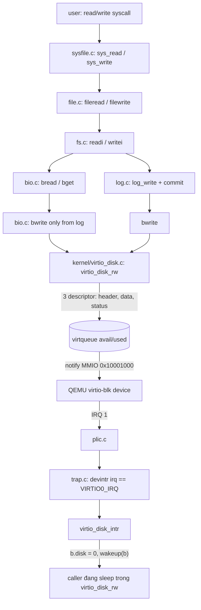
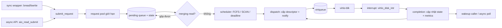
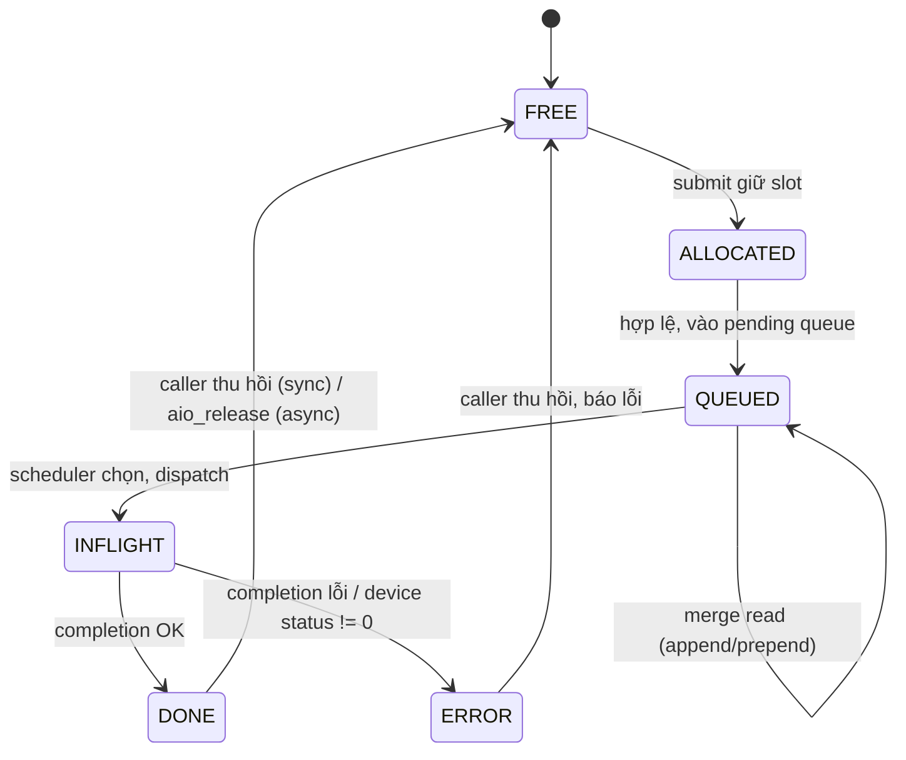

# Kiến trúc đường I/O và thiết kế đề xuất

Tài liệu này mô tả **hiện trạng** đường I/O của xv6-riscv đang pin
(`f780d785`) và **thiết kế đề xuất** cho đề tài: async virtio-blk + scheduler
FCFS/SCAN/deadline + request merging. Đây là bản nháp kỹ thuật cho proposal
tuần 3, không phải đặc tả đã chốt với giảng viên.

## 1. Đường I/O hiện tại (stock xv6)

### 1.1 Sơ đồ tầng



### 1.2 Các file/hàm quan trọng

| File | Vai trò |
| --- | --- |
| `kernel/bio.c` | buffer cache: `bget`, `bread`, `bwrite`, `brelse`, `bpin/bunpin` |
| `kernel/log.c` | write-ahead log: `begin_op`, `log_write`, `end_op`, `commit`, `install_trans` |
| `kernel/fs.c` | inode/block mapping: `readi`, `writei`, `bmap` |
| `kernel/virtio_disk.c` | driver MMIO virtio-blk: `virtio_disk_init`, `virtio_disk_rw`, `virtio_disk_intr` |
| `kernel/virtio.h` | thanh ghi MMIO, `NUM=8` descriptor, `struct virtio_blk_req`, ring |
| `kernel/trap.c` | `devintr()`: nhận IRQ, gọi `virtio_disk_intr()` |
| `kernel/plic.c` | cấu hình PLIC, `plic_handle_irq` |
| `kernel/sleeplock.c` | `acquiresleep/releasesleep` dùng `sleep_prepare()` + `sleep()` |
| `kernel/proc.c` | `sleep_prepare()`, `sleep()`, `wakeup()` (API mới của xv6) |

### 1.3 Thông số thực tế cần nhớ

| Thông số | Giá trị | Nơi định nghĩa |
| --- | --- | --- |
| Số descriptor | `NUM = 8` | `kernel/virtio.h` |
| Descriptor mỗi request | 3 (header + data + status) | `virtio_disk_rw` |
| Số chain tối đa đồng thời | `floor(8/3) = 2` | suy ra từ trên |
| Kích thước block FS | `BSIZE = 1024` | `kernel/fs.h` |
| Kích thước sector virtio | 512 byte | `virtio_disk_rw`: `sector = blockno * (BSIZE/512)` |
| Số buffer cache | `NBUF = 30` (= `MAXOPBLOCKS*3`) | `kernel/param.h` |
| FS | `FSSIZE = 2000` block (~2 MiB) | `kernel/param.h` |
| Capacity thiết bị (sector) | `FSSIZE * 2` sector | suy ra |
| MMIO base / IRQ | `0x10001000` / 1 | `kernel/memlayout.h` |

### 1.4 Hành vi đồng thời của stock (quan trọng)

- `virtio_disk_rw` giữ `disk.vdisk_lock` khi cấp descriptor và format request.
- Khi submit, driver đặt `avail->ring[idx] = idx[0]`, `avail->idx++`, `io_fence()`
  rồi notify. Sau đó **sleep trên `b`** (giải phóng `vdisk_lock` trong lúc ngủ).
- Vì lock được giải phóng khi sleep, **process khác có thể submit** request mới
  trong lúc request trước còn INFLIGHT. Upstream vì vậy **không** phải "chỉ 1
  request toàn hệ thống", nhưng bị chặn bởi **8 descriptor / 3 mỗi chain = tối
  đa 2 chain** cùng lúc; caller thứ 3 ngủ chờ `disk.free[0]`.
- `bwrite` chỉ được log gọi (`log.c`), nên write đi qua log commit — đây là lý do
  giai đoạn đầu **không reorder/merge write**.
- Completion: `virtio_disk_intr` duyệt used ring, kiểm tra status, lấy
  `disk.info[id].b`, đặt `b->disk = 0`, `wakeup(b)`, tăng `used_idx`.
- **Baseline chưa đo max_inflight thực tế** — cần spike thêm counter
  (`nr_dispatch - nr_complete`, `max`) để có bằng chứng định lượng cho R01.
  Xem "Việc cần làm" ở cuối.

### 1.5 API sleep mới — khác sách xv6

Commit đang pin dùng cặp `sleep_prepare(chan)` + `sleep()` thay cho
`sleep(chan, lock)` cũ:

```c
// kernel/proc.c
void sleep_prepare(void *chan);  // ghi nhận channel muốn ngủ
void sleep(void);                // ngủ, trả về ngay nếu chan đã bị wakeup
void wakeup(void *chan);
```

Mẫu dùng (theo `sleeplock.c`, `virtio_disk_rw`):

```c
sleep_prepare(chan);
release(&lk);   // mở khóa TRƯỚC khi ngủ
sleep();
acquire(&lk);
```

Ý nghĩa: tránh **mất wakeup** khi dấu hiệu completion đến giữa lúc chờ lock và
lúc thực sự ngủ. Khi code async/completion, **phải dùng đúng mẫu này**; nếu
dựa vào tài liệu cũ trên mạng, sẽ sai. Đây cũng là điểm cần hỏi giảng viên khi
chốt tag: tag học phần có thể dùng API cũ.

## 2. Thiết kế đề xuất cho đề tài

### 2.1 Nguyên tắc

- **Không phá API đồng bộ cũ**: `bread/bwrite` vẫn là wrapper `submit + wait`.
  Test stock (`usertests`, `grind`) phải tiếp tục chạy.
- Thêm **request pool hữu hạn** và **pending queue phần mềm** đứng trước virtqueue.
- Scheduler chỉ chọn trong các request **QUEUED**; INFLIGHT giữ nguyên khi đổi
  policy.
- Bản đầu chỉ **merge read** và **không reorder write** (write fence), để không
  làm sai logging.
- Mọi counter đo đạc nằm trong kernel (không printf từ interrupt path).

### 2.2 Sơ đồ khối



### 2.3 Request và vòng đời

Đề xuất `struct io_request` gồm:

| Nhóm | Trường |
| --- | --- |
| identity | `id` + `generation`, `dev`, `op` (READ/WRITE), `flags` |
| địa chỉ | `sector` (đơn vị 512B), `nbytes`, segment list / buffer |
| trạng thái | `state`, `error`, `ordering domain` |
| thời gian | `t_enqueue`, `t_dispatch`, `t_complete` (ticks/counter) |
| policy | `deadline`, `enqueue_seq` |
| merge | `parent`, `children[]`, `merged_count` |



Bất biến:

- Chỉ merge request **QUEUED**; không bao giờ merge INFLIGHT.
- Handle/buffer DMA chỉ được tái sử dụng **sau** khi device xong **và** caller
  đã thu hồi kết quả.
- Completion cha phải xong **đúng một lần** cho từng request con đã merge.
- Pool/queue đầy: trả lỗi có định nghĩa (`-EAGAIN`/`-ENOMEM`), không chặn vô hạn
  trong interrupt, không cấp phát động trong interrupt.

### 2.4 Ba chính sách

| Policy | Quy tắc chọn | Test oracle |
| --- | --- | --- |
| FCFS | `enqueue_seq` nhỏ nhất trong QUEUED | thứ tự dispatch đúng trace |
| SCAN | sector theo chiều hiện tại; đến biên capacity thì đảo chiều; lưu `head_pos`, `direction` | trace dispatch có đầu đọc logic + chiều; phân biệt LOOK |
| Deadline | request quá hạn trước; còn lại theo sector trong batch giới hạn; tie-break `enqueue_seq` | test request quá hạn trong luồng request mới liên tục; không starvation |

Ghi chú:

- **Biên SCAN lấy từ device capacity** (sector), không nhầm block/sector; không
  tạo I/O giả tới biên.
- Nếu "quay đầu ngay tại request cuối" thì đó là **LOOK** — phải gọi đúng tên
  hoặc xin giảng viên chấp thuận.
- Deadline là chính sách phần mềm giảm nguy cơ đói; **không cam kết** real-time.
- Đổi policy khi đang chạy: dưới cùng lock queue; giữ id/arrival/state; reset
  state riêng của policy theo quy tắc công bố; `INFLIGHT` tiếp tục hoàn thành;
  tăng `policy_switch`. Phải test đổi khi **QUEUED và INFLIGHT đều khác rỗng**.

### 2.5 Merge request (read trước)

Điều kiện gộp: cùng device, cùng op, **liền kề sector**, cùng ordering domain,
không vượt giới hạn size/segment/descriptor. Hỗ trợ **append và prepend**.

- Gửi **một lệnh thiết bị** bao phủ nhiều block (không phải chỉ gom list rồi
  submit từng lệnh).
- Buffer không nhất thiết liền nhau trong RAM: dùng scatter-gather nếu feature
  cho phép, hoặc bounce buffer có giới hạn.
- Phải tính **header + status descriptor**; giới hạn queue 8 descriptor; NBUF.
- `sector` 512B; tổng byte phải là bội số 512 và trong capacity.

### 2.6 Đồng bộ, khóa, ownership

**ĐÃ CHỐT (W2-G01, 30/10/2026):** dùng **một lock domain duy nhất** `io_lock`
(chính là `disk.vdisk_lock`, truy cập qua `virtio_disk_io_lock()`) bảo vệ
request pool + queue + state + descriptor/ring/head-map + `b->disk`; không có
khóa thứ hai, không acquire lồng, không ngủ khi giữ khóa. Hai khóa
`ioq.lock`/`vdisk_lock` bị loại vì đảo chiều khóa giữa enqueue và completion
(xem phân tích trong [`week02/interface.md`](week02/interface.md) D6).

Đề xuất ban đầu giữ nguyên làm lịch sử: một spinlock bảo vệ pending queue +
request state + kế toán descriptor; chưa tối ưu nhiều khóa. Ghi rõ:

- Thứ tự khóa hiện tại: `bcache.lock` → `buf.lock` (sleeplock) → `disk.vdisk_lock`.
  Nếu thêm `ioq.lock`, phải định nghĩa thứ tự và ghi vào tài liệu.
- Interrupt không sleep, không cấp phát có thể block, không printf mỗi request
  khi benchmark; completion chỉ đánh dấu + wakeup.
- Memory ordering khi publish `avail` và đọc `used` theo driver đã xác nhận
  (`io_fence()`).
- Async: buffer được giữ hợp lệ tới completion bằng ownership/refcount; copy ra
  user space thực hiện trong process context; **không** giữ user pointer tự do
  cho DMA sau khi process thoát.

### 2.7 API async đề xuất (chưa phải tên syscall chốt)

**ĐÃ CHỐT cho tuần 2 (W2-G01):** kernel-level C API, READ một block
`BSIZE=1024`, đơn vị địa chỉ là **blockno**, buffer do pool sở hữu. Nguồn sự
thật + semantics đầy đủ:
[`docs/week02/interface.md`](week02/interface.md) §2–§3 và
[`kernel/io_request.h`](../kernel/io_request.h).

```c
int aio_read_submit(uint dev, uint blockno, struct io_handle *out); // 0 hoặc -E*
int aio_poll(struct io_handle h);        // 1 DONE, 0 đang bay, -EIO/-E*
int aio_wait(struct io_handle h);        // process ctx; 0 DONE, -EIO/-E*
int aio_release(struct io_handle h);     // chỉ terminal; 0 hoặc -EBUSY/-E*
void *aio_data(struct io_handle h);      // staging buffer của pool, đọc sau DONE
```

Bản nháp cũ `aio_read_submit(dev, sector, buf, nbytes)` + caller-owned `kbuf`
đã bị thay thế (xem banner đầu `docs/week01/decisions_report.md`).

Cần chốt với giảng viên: **syscall user-space** hay **API kernel + chương trình
minh hoạ**. Bản base hiện tại chưa thêm syscall nào.

### 2.8 Đo đạc

- Lưu `t_enqueue`, `t_dispatch`, `t_complete`; tính:
  - `queue_wait = t_dispatch - t_enqueue`
  - `service = t_complete - t_dispatch`
  - `latency = t_complete - t_enqueue`
- Counter: `max_inflight` (bằng chứng R01 ≥ 2), `merge_ratio`, `policy_switch`,
  `descriptor_exhausted`, `request_error`.
- Outstanding = đã submit device nhưng chưa complete; **khác** pending phần mềm.
- Timer tick quá thô thì dùng timebase/counter phù hợp và ghi cách quy đổi.

## 3. Rủi ro kỹ thuật (từ kế hoạch)

| Rủi ro | Giảm thiểu |
| --- | --- |
| Mất wakeup / deadlock | dùng đúng `sleep_prepare`+`sleep`; test complete-before-wait; CPUS=1/4 |
| Use-after-free DMA | ownership/refcount, drain, generation; test kill/exit |
| Reorder write sai logging | write đồng bộ + fence; không merge write giai đoạn đầu |
| Merge sai dữ liệu / rò descriptor | segment bounds, checksum, completion con, exhaustion test |
| Không có nhiều request để lập lịch | nhiều producer + queue depth; đo pending/inflight |
| Tag/API khác tag học phần | pin commit + ghi chú; hỏi GV trước khi code sâu |

## 4. Việc cần làm ngay (tuần 1 → 2)

- [ ] Chốt tag xv6 chính thức, cập nhật `.xv6-commit` bằng `scripts/update-xv6.sh`.
- [ ] Spike counter `inflight/max_inflight` trên bản stock để **đo baseline
      thực tế** (nhánh riêng, review, không vào driver chính thức).
- [ ] Vẽ bản đồ `bread/bwrite → virtio_disk_rw → interrupt → wakeup` (mục 1)
      và review chéo trong nhóm.
- [ ] Chốt tên/định nghĩa SCAN và phạm vi merging với giảng viên.
- [ ] Thiết kế request struct + state machine (mục 2.3) trước khi code.
