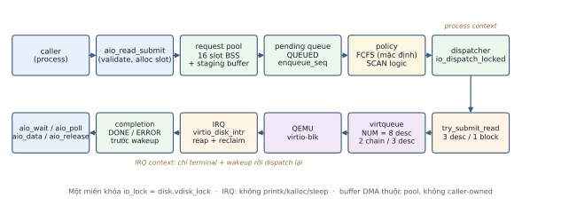

# Proposal kỹ thuật — Asynchronous virtio-blk và I/O schedulers trên xv6-riscv

> **Đề tài:** 26128 — nhóm 3 (ET4290, HK 2026.1) · **Người soạn:** Phạm Trung Hiếu (20233402)
> **Phiên bản:** v1.0-draft, 2026-11-07 · **Base revision:** `49557bf671edb5ee4ccf6a2c3c452d32fd1f411e`
> **Pin xv6:** `f780d785…` (tạm thời, PTO-7/Q1) · **Reviewers:** Nguyễn Văn Hoàng (driver/lifetime),
> Phạm Quý Lợi (policy/oracle) — **PENDING**.
> **Nguồn:** [`docs/week03/interface.md`](interface.md), [`docs/week03/lifecycle-review.md`](lifecycle-review.md),
> [`docs/week02/interface.md`](../week02/interface.md); PDF/build: [`docs/week03/README.md`](README.md).

## 1. Bài toán và mục tiêu

xv6-riscv hiện thực I/O đĩa theo mô hình đồng bộ: mỗi `bread`/`bwrite` đi qua
`virtio_disk_rw`, submit một chain 3 descriptor rồi **ngủ** chờ ngắt; caller thứ ba
bị chặn vì virtqueue chỉ có 8 descriptor (`NUM=8`) tức tối đa 2 chain song song.
Đề tài xây dựng **đường I/O có hàng đợi** cho xv6-riscv: nhiều request outstanding,
scheduler phần mềm **FCFS / SCAN / deadline**, gộp request và API đọc bất đồng bộ,
kèm test tự động, đo lường và demo đổi policy khi hệ thống đang chạy.

Mục tiêu tuần 3: chuyển nguyên mẫu **READ-FCFS** đã merge lên `main` sang **SCAN
logic có contract và oracle**, đồng thời hoàn thiện proposal này. Kết quả cần hướng
tới: hai policy chạy được với READ thật trên CPU1/4, trace/oracle độc lập, production
regression giữ nguyên, và proposal phản ánh đúng phần đã có/chưa có.

## 2. Phạm vi và non-goals

| Trong phạm vi MVP tuần 2–3 | Ngoài phạm vi (backlog / chờ GV) |
| :--- | :--- |
| READ **1 block** (`BSIZE=1024`), một thiết bị `ROOTDEV` | Async WRITE; thay thế `bread()/bwrite()` |
| Pool **16 slot**, staging buffer thuộc pool, handle `(id,gen)` | Syscall/API user (PTO-7/Q3) |
| **Một** `io_lock` (= `disk.vdisk_lock`), không ngủ khi giữ khóa | Merge READ, deadline scheduler |
| Queue FCFS (mặc định) + **SCAN logic** chọn ở test config | Đổi policy khi có tải (tuần 4) |
| Trace + oracle, bất biến kế toán, production restore | Coherence với buffer cache; đo hiệu năng/seek |
| Kill/cancel: **chỉ thiết kế** (W3-I01) | Triển khai kill/cancel, timeout, fd-table |

Không có trong proposal này: khẳng định tăng tốc I/O, phê duyệt của GV, hay kết quả
merge/deadline/coherence khi chưa có bằng chứng.

## 3. Kiến trúc hiện tại (sau tuần 2, trên `main` 49557bf)

{ width=82% }

*Hình 1 — Pipeline async READ. Nguồn sửa được: [`diagrams/make_diagrams.py`](diagrams/make_diagrams.py)
sinh [`architecture-pipeline.svg`](diagrams/architecture-pipeline.svg).*

| Thành phần | File | Trách nhiệm |
| :--- | :--- | :--- |
| Request layer | `kernel/io_request.c` | Pool BSS 16 slot, state/handle/`gen`, `aio_read_submit/poll/wait/data/release`, counters |
| Scheduler/queue | `kernel/io_queue.c` | Hàng đợi `QUEUED`, `enqueue_seq`, dispatcher FCFS (SCAN ở tuần 3) |
| Driver | `kernel/virtio_disk.c` | `try-submit` READ 3 descriptor, owner map, IRQ reap + reclaim ASYNC, stock reclaim |
| Header contract | `kernel/io_request.h` | Kiểu dữ liệu, enum, prototype, quy tắc khóa/ownership |
| Tích hợp test | `kernel/io_request_test.c`, `kernel/io_queue_test.c`, `scripts/io-selftest.sh` | Selftest `-DIO_SELFTEST`, mock queue `-DIOQ_SELFTEST`, READ thật `-DIO_HW_SELFTEST` |

**Vòng đời request:** `FREE → ALLOCATED → QUEUED → INFLIGHT → DONE | ERROR → FREE`.
`DONE/ERROR` vẫn chiếm slot tới khi caller `aio_release()`; descriptor là vòng đời
riêng (`FREE → RESERVED → PUBLISHED → USED → RECLAIMED`), có thể tái dùng cho request
khác trước khi caller của request cũ release (head reuse).

**Ownership và khóa:** đúng một `io_lock` bảo vệ pool + queue + state + ring/owner
map + `b->disk`; `sleep_prepare() → release(io_lock) → sleep() → acquire(io_lock)`;
completion cập nhật terminal **trước** `wakeup`; IRQ không `printk`/`kalloc`/`sleep`.
Descriptor ASYNC do IRQ giải phóng, STOCK do caller `virtio_disk_rw` giải phóng;
slot do caller qua `aio_release`. Buffer DMA nằm trong BSS, không `kalloc`, không
caller-owned.

## 4. Điều phối: FCFS đã có, SCAN logic theo contract W3-G01

**FCFS (mặc định production)** chọn request có `enqueue_seq` nhỏ nhất; completion
không quyết định thứ tự. **SCAN logic (tuần 3)** dùng `logical_head` + `direction`
trên miền `blockno 0..FSSIZE-1`:

- khởi tạo `head = 0`, `direction = +`; queue rỗng không đổi trạng thái;
- ưu tiên request đúng `head`; nếu không, chọn block gần nhất theo chiều hiện tại,
  tie-break `enqueue_seq`;
- khi không còn ứng viên theo chiều: ghi **sự kiện biên logic** (`1999` hoặc `0`),
  đảo chiều, **không phát READ giả** tới biên;
- `try-submit` trả `IO_EAGAIN` ⇒ **không commit** head/direction/trace, giữ nguyên
  request và `enqueue_seq`, retry ở lần dispatch sau.

| Fixture (queue nạp sẵn, seq 1..5 = block 70,20,90,10,50; head 40, tăng) | Thứ tự dispatch |
| :--- | :--- |
| FCFS | 70, 20, 90, 10, 50 |
| SCAN logic | 50, 70, 90 → **BOUNDARY(1999)** → 20, 10 |

SCAN và LOOK có thể cho **cùng thứ tự block** ở nhiều queue tĩnh; vì vậy oracle phải
kiểm **boundary event/head/direction**, không chỉ so dãy block. Định nghĩa chính xác
và 8 nhóm test: [`docs/week03/interface.md`](interface.md) D11–D20. Đây là điều phối
phần mềm trên QEMU — **không** đo chuyển đầu từ vật lý.

## 5. Kết quả tuần 2 — có revision và phân loại bằng chứng

| Hạng mục | Kết quả | Bằng chứng |
| :--- | :--- | :--- |
| Tích hợp READ thật | 20/20 lượt boot READ (10×CPU1 + 10×CPU4) trên máy Hoàng | [`results/week02/hoang-20261101-213746/summary.md`](../../results/week02/hoang-20261101-213746/summary.md) |
| Chạy lại độc lập | 20/20 + 4/4 mock/timer trên máy Lợi | [`results/week02/laptop-Loi/integration-2026-11-01_222438/summary.md`](../../results/week02/laptop-Loi/integration-2026-11-01_222438/summary.md) |
| Mock/timer (không phải READ thật) | pool-mock-timer + queue-mock PASS CPU1/4 | cùng summary trên; `results/week02/laptop-Loi/mock-2026-11-01_151853/` |
| Production regression | 6/6 PASS: boot, shell, `usertests -q` CPU1/4, `grind 60s` CPU1/4 | [`.../regression-final/summary.md`](../../results/week02/hoang-20261101-213746/regression-final/summary.md) |
| Negative control | Fixture hỏng: **EXPECTED_FAIL** (không phải PASS) | `negative-corrupt-fixture.log` trong summary trên |
| Nguồn tích hợp | PR #5 `83745b6` (READ thật) và PR #6 `49557bf` merge tuần 2, 2026-11-04 | `git log origin/main` |

**Đọc đúng số liệu:** `max_inflight = 2` là số chain đã publish mà phần mềm chưa
reap (= `floor(NUM/3)`), **không** phải bằng chứng thiết bị thực thi song song hay
tăng tốc I/O. Các lượt boot không phải "test độc lập" và không được cộng thành 600
test. Kiểm nhanh sau merge ngày 07/11 trên base này:
`make test-fast` **PASS 2/2** (smoke boot/shell, không thay bộ nghiệm thu G02) —
[`results/week03/hieu-contract-lifecycle-2026-11-07/`](../../results/week03/hieu-contract-lifecycle-2026-11-07/summary.md).

## 6. Đo lường và kiểm thử

| Lớp | Cách kiểm | Trạng thái tuần 3 |
| :--- | :--- | :--- |
| Contract/header | Compile nghiêm ngặt + `_Static_assert` kích thước/layout | Đã có từ W2-G01 |
| Pool/handle/wait | Selftest T02–T06, T11, stale/release-active | PASS tuần 2; chạy lại khi sửa |
| FCFS | Trace cũ `seq=1..5`; 20 boot FCFS; `EAGAIN` không mất/lặp | L01/L02/G02 |
| SCAN | ≥ 8 nhóm oracle độc lập; boundary/tie/unlink; 2 mutant phải bị bắt | L02; **NOT RUN** ở G01 |
| READ thật + regression | FCFS/SCAN × CPU1/4 chạy lại máy hai; boot/shell/`usertests -q`/`grind 60s` = 6 case | G02 |
| Tài nguyên + âm bản | Drain `free_req=16`, `free_desc=8`, `Q=I=D=X=0`; fixture sai byte/mutant/timeout = FAIL | Hiếu review |
| Bất biến kế toán | `submitted = Q+I+D+X`; `C+E = R+D+X`; `16 = F+Q+I+D+X`; snapshot một khóa | Hiếu review |

Instrumentation: `t_enqueue/t_dispatch/t_complete` (tick), counters request-layer +
driver, `max_inflight`; snapshot dưới `io_lock`, in ngoài IRQ. Tick hẹp hơn thời gian
I/O thật nên chưa dùng để tuyên bố độ trễ; QEMU không mô phỏng seek.

## 7. Rủi ro và giới hạn

| Rủi ro | Giới hạn / giảm thiểu |
| :--- | :--- |
| Kill/exit làm rò rỉ slot | Đã rà soát: rò rỉ là hệ quả chính; thiết kế owner/orphan ở W3-I01, **chưa triển khai** |
| SCAN/LOOK chưa được GV xác nhận | Dùng SCAN logic tạm, ghi Pending PTO-7/Q4; oracle kiểm boundary event |
| Thiếu descriptor (`NUM=8`) | `EAGAIN` bảo toàn queue/head; test pressure; không mở `NUM` khi chưa có Q7 |
| Coherence khi cùng block vừa đọc vừa ghi | Chưa giải quyết; chỉ đọc fixture read-only; không thay `bread()` |
| Bằng chứng/hạ tầng bị hiểu sai | Mock/timer báo riêng, không tính READ thật; kết quả ghi theo máy/toolchain (H01); CI đang comment nên không coi CI PASS là bằng chứng |

## 8. Lộ trình tuần 4–7 (đề xuất, chưa cam kết kết quả)

| Tuần | Công việc | Đầu ra kiểm được |
| :---: | :--- | :--- |
| 4 | Tích hợp SCAN + READ thật (G02); **deadline** policy; đo trace/latency; bắt đầu merge READ design; (nếu đủ thời gian) owner/cancel theo W3-I01 | Trace oracle 2 policy; commit + log FCFS/SCAN; review |
| 5 | Merge READ bằng **segment/copy plan** có giới hạn (không tuyên bố trước); quyết định coherence với `bread`; test merge + negative control | Test merge/drain; tài liệu quyết định coherence |
| 6 | Theo Q2/Q3: syscall/API user + chương trình demo, hoặc giữ kernel API + demo; async WRITE nếu được duyệt | Demo + log; cập nhật contract |
| 7 | Hardening, đo theo rubric (Q6), báo cáo/demo cuối; chốt phần chuyển tiếp | Báo cáo + PDF + log tái lập |

Mọi mục tuần 4–7 là **kế hoạch**; chỉ ghi Done khi có review + log + commit.

## 9. Câu hỏi cần GV xác nhận (PTO-7, đang Pending)

**Q1** tag/commit xv6 chính thức (đang pin tạm `f780d785`) · **Q2** chỉ READ async +
WRITE đồng bộ có đạt? · **Q3** kernel C API + demo hay bắt buộc syscall user? ·
**Q4** SCAN truyền thống hay LOOK, quy tắc biên logic? · **Q5** phạm vi merge READ
(số block, điều kiện thứ tự)? · **Q6** trọng số rubric Functionality/Testing/
Measurement? · **Q7** có cần tăng `NUM` để chứng minh `max_inflight > 2`? ·
**Q8** kill/cancel/exit có bắt buộc trong học phần? — Không câu trả lời nào được coi
là đã xác nhận.

## 10. Tham chiếu

Contract tuần 2 [`docs/week02/interface.md`](../week02/interface.md) · header
[`kernel/io_request.h`](../../kernel/io_request.h) · kiến trúc
[`docs/architecture.md`](../architecture.md) · contract SCAN
[`docs/week03/interface.md`](interface.md) · lifecycle/kill-cancel
[`docs/week03/lifecycle-review.md`](lifecycle-review.md) · bằng chứng
[`results/week02/`](../../results/week02/) và [`results/week03/`](../../results/week03/) ·
sơ đồ [`docs/week03/diagrams/`](diagrams/) (nguồn + SVG + script sinh).

*Tài liệu này là bản nháp kỹ thuật, không thay thế báo cáo tuần và chưa được GV phê duyệt.*
